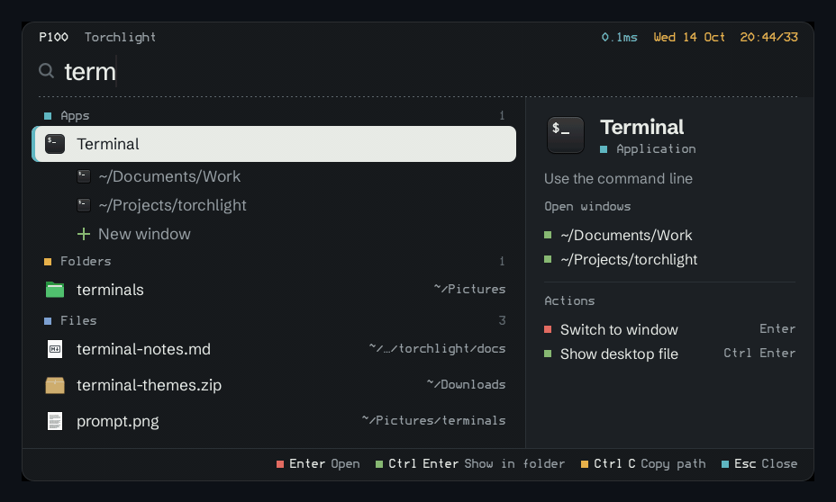

# Torchlight

A launcher for Linux I'm building. Hit a shortcut, type a few letters, and open an app, a
setting, a file or a folder, or jump to a window that's already open. Written in C with
GTK 4; works on X11 and Wayland.



- **Typos are fine.** `raedme` finds `README.md`, `prjnts` finds `projectNotes.md`, and
  `work notes` finds the notes folder inside Work.
- **Fast and always current.** A small daemon keeps the index in memory and follows file
  changes as they happen. Typing stays under about 5 ms, even with 500,000 files
  ([evaluation](docs/evaluation.md)).
- **Open windows.** Running apps list their windows beneath them and Enter switches to
  one, on X11 and most Wayland desktops ([which ones](docs/desktop-setup.md#open-windows)).
- **Private.** It learns what you open, but that history stays on your machine and can be
  turned off. Only file names and paths are indexed, never what's inside the files.

## Install

**Ubuntu 24.04+, Linux Mint 22+ and other Ubuntu-based systems:** download
`torchlight_VERSION_amd64.deb` from the
[latest release](https://github.com/antash-mishra/torchlight/releases/latest) and install
it:

```sh
sudo apt install ./torchlight_*_amd64.deb
```

It also adds Torchlight's APT repository, so new versions arrive with your other updates.

**Fedora, Arch, openSUSE, Debian 13 and other distributions:** download
`torchlight-VERSION-linux-x86_64.tar.gz` from the same page and run its installer. It sets
Torchlight up just for you, in `~/.local`, without root:

```sh
tar xf torchlight-*-linux-x86_64.tar.gz
./torchlight-*-linux-x86_64/install.sh
```

To update, do the same with a newer release; `install.sh --uninstall` removes it. It needs
GTK 4.14 or newer, which distributions from 2024 on have.

Then bind `torchlight-gtk --toggle` (the installer prints its full path) to a keyboard
shortcut such as Super+Space; [desktop setup](docs/desktop-setup.md) says where on each
desktop. To build it yourself, see [building](docs/building.md).

## Use

| Key | Action |
|---|---|
| Type | Search apps, settings, files and folders |
| ↑ ↓ | Move the selection |
| Enter | Open it, or switch to the window |
| Ctrl+Enter | Show it in its folder |
| Ctrl+C | Copy its path |
| Esc | Close |

Torchlight indexes your home folder. To pick other folders, change how the daemon runs or
search from a terminal, see [configuration](docs/configuration.md).

## More

- [Building](docs/building.md): from source, a headless build for servers, and development
- [Configuration](docs/configuration.md): folders, daemon options and the command line
- [Desktop setup](docs/desktop-setup.md): shortcuts and open windows on each desktop
- [Docs index](docs/README.md): architecture, evaluation and design decisions

## Contributing

Pull requests are welcome: fork the repository, make your change on a branch and open a
pull request against `master`. Read [CLAUDE.md](CLAUDE.md) for the code rules, and run
`make test` and `make lint` first. I review and merge pull requests and publish the
releases.

## License

MIT; see [LICENSE](LICENSE). Bundled parts keep their own licenses, listed in
[third_party/README.md](third_party/README.md), and release builds also contain SQLite
(public domain) and utf8proc (MIT).
